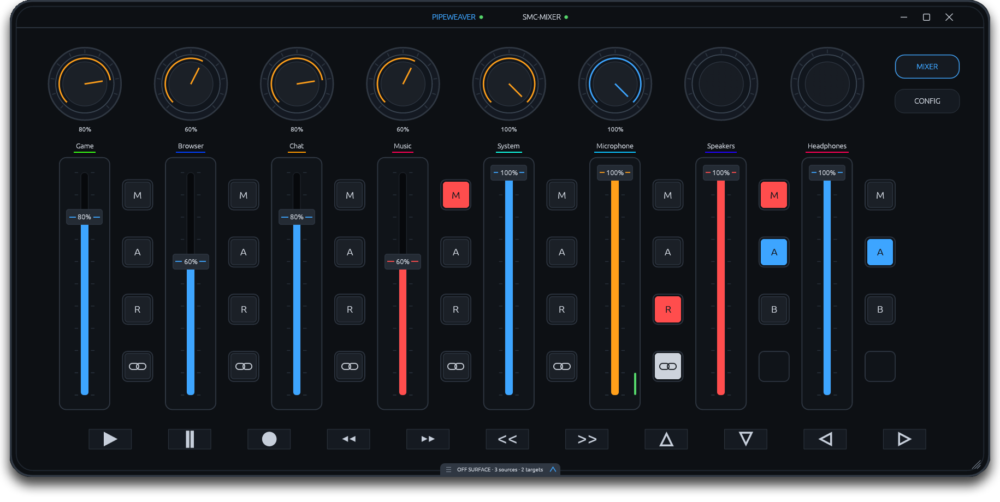

<p align="center">
  
</p>

<p align="center">
  <strong>A dedicated control surface for the M-VAVE SMC-Mixer and Pipeweaver.</strong><br>
  Eight strips, one fixed mapping, no MIDI learn.
</p>

<p align="center">
  <a href="LICENSE"></a>
  <a href="VERSION"></a>
  <a href="https://ko-fi.com/desynkro"></a>
</p>

<p align="center">
  Built by <a href="https://desynkro.com">DeSynkro</a> with assistance from <a href="https://opencode.ai">OpenCode</a>.
</p>

Pipeweaver SMC Mixer turns the M-VAVE [SMC-Mixer](https://www.m-vave.com/product?id=smc-mixer) into a dedicated hardware surface for [Pipeweaver](https://github.com/pipeweaver/pipeweaver). The faceplate on screen matches the mixer in front of you. The faders and knobs drive Pipeweaver's Personal and Audience mixes, the buttons handle mutes, swaps and links, and the transport row controls your media player.

This is a focused app. It only supports the SMC-Mixer and it only talks to Pipeweaver. There is no mapping editor, no plugin system and no setup wizard. Plug the mixer in, start Pipeweaver and go.

<p align="center">
  
</p>

## Why this exists

When I first moved to Linux, I had to work around my audio setup without the convenience of my old Beacn Mix Create, as Beacn never release a Linux build.

I looked up online and ended up finding the SMC-Mixer by M-VAVE, a small, affordable MIDI controller with eight strips, eight knobs and a row of buttons. Fantastic little Audio Midi Table.

I spent weeks trying to get it to work with Linux and to my dismay, I never managed to get it working, until a gentleman by the name of FrostyCoolSlug released [Pipeweaver](https://github.com/pipeweaver/pipeweaver).

Pipeweaver is a flexible audio mixer for Linux and I was able to pair them well together. The mapping is fixed, the labels follow Pipeweaver, and the screen looks like the device. 
If you own an SMC-Mixer and use Pipeweaver, it should feel like the mixer was made for it.

It's a very niche software for a niche situation, but I thought i'd share if anyone wants to have a go in making it compatible with their own device or falls under the same niche I did.

## Requirements

- **Linux** with Wayland or X11.
- **Pipeweaver** installed and running. The app talks to it on `localhost:14565`.
- **M-VAVE SMC-Mixer preferably on its factory preset**, connected over USB or Bluetooth. The app expects the mapping in [SMC mapping](#smc-mapping). No programming should be needed unless the unit has been remapped.
- **For the AppImage**: FUSE, or run it with `--appimage-extract-and-run`, plus a recent glibc and the usual Pipeweaver/audio/graphics stack. The Docker build uses Debian bookworm (glibc 2.36). A native build uses the host's glibc. 

### Build requirements

Building from source needs Rust 1.85 or newer (the workspace uses edition 2024), Cargo, a C linker, `pkg-config`, and the development headers for ALSA, X11/Wayland, OpenGL and D-Bus. On Debian/Ubuntu:

```sh
sudo apt install build-essential pkg-config git curl ca-certificates file \
  libasound2-dev libx11-dev libx11-xcb-dev libxcb1-dev \
  libxcb-render0-dev libxcb-shape0-dev libxcb-xfixes0-dev \
  libxcb-randr0-dev libxcb-xkb-dev libxkbcommon-dev \
  libxkbcommon-x11-dev libwayland-dev wayland-protocols \
  libxrandr-dev libxi-dev libxcursor-dev libxinerama-dev \
  libgl1-mesa-dev libegl1-mesa-dev libdbus-1-dev
```

### Building with Docker Compose

If you have Docker Compose but not the build dependencies:

```sh
./build/build.sh docker
# or
./build/docker/build-in-docker.sh
```

It prompts for binary and/or AppImage. Pressing Enter picks the default. The first run downloads the base image and Cargo dependencies; later runs reuse the cache in `build/docker/cargo-cache`.

The container is build-only. It does not run the app or pass through the desktop, audio or MIDI devices. Plain `docker compose` is used when it works without sudo, otherwise the script uses `sudo docker compose`. Set `COMPOSE="..."` or `DOCKER="..."` to override.

Docker outputs stay in `build/docker/out/`, separate from the native `build/binary/` and `build/appimage/` outputs. The container is Debian bookworm (glibc 2.36), so Docker-built binaries need glibc 2.36 or newer at runtime.

The AppImage does not bundle glibc or the graphics/audio libraries, so it has the same baseline. See `build/docker/README.md` for details.

## Build and run from source

```sh
./build/build.sh binary
./build/install-desktop.sh
./build/run.sh --quiet
```

`./build/build.sh` with no argument opens a menu for Binary, AppImage or Docker. Pass `binary`, `appimage` or `docker` to skip the menu.

Build the AppImage locally:

```sh
./build/build.sh appimage
```

The result is `build/appimage/Pipeweaver-SMC-Mixer-x86_64.AppImage`. Release builds rename it to the versioned filename. See [RELEASING.md](RELEASING.md).

The install step adds the desktop entry and hicolor icons, so the taskbar and
launcher use the app logo instead of a generic icon.

Start Pipeweaver first. The app starts in the tray when launched with `--quiet`, or shows the window when launched normally.

Once published, the AppImage will be on the releases page:

```sh
chmod +x Pipeweaver-SMC-Mixer-1.2.0-x86_64.AppImage
./Pipeweaver-SMC-Mixer-1.2.0-x86_64.AppImage
```

## Features

- **Fixed SMC mapping:** faders, knobs, M/S/R and the link button, all on the documented CCs. No learn mode.
- **Personal and Audience:** faders control the A mix, knobs control the B mix, R swaps them per strip.
- **Soft takeover:** faders and knobs wait for the current value before taking over.
- **Endless knobs:** in relative mode every detent is one step in either direction, so the knobs never hit the mixer's 0/127 limits. The app detects the mode and can switch the preset it uses on the mixer, with a warning and a full backup first.
- **Linked sources:** linked keeps the Personal/Audience ratio. Optional restrictions can disable the hardware Audience knob or the reverse function (R) while a source is linked.
- **Targets:** target faders, mutes and explicit A/B routing. The bar follows the active mix.
- **Split:** share the eight strips between sources and targets, from 8/0 down to 4/4. Default is 6/2.
- **Off-surface channels:** extra sources and targets stay reachable in a drawer. It can be hidden in Config.
- **LED feedback:** M, S, R and link LEDs follow the state. The arrow LEDs stay local.
- **Startup animations:** eight selectable styles, from Classic to Rain. Choosing one in Config previews it immediately, and the animation can be disabled.
- **Pipeweaver screen:** running applications with their routes, and the full source-to-target routing table, on one page. Stopped applications linger for ten seconds so a route can still be changed.
- **Sleep and shutdown blackout:** the 32 strip LEDs are turned off before suspend and power-off. The firmware-owned transport LEDs remain unchanged.
- **App button:** a short press shows or hides the app; holding for one second opens it on the Pipeweaver screen. The old right-arrow Pipeweaver shortcut is unbound.
- **Transport:** play, pause, record, seek, track skip and the split buttons.
- **Record button:** hold for [Hex](https://github.com/anomalyco/hex) dictation, or enable Toggle Hex recording in Config or the tray to press once to start and again to stop. When Hex mode is off, tap toggles the default microphone mute.
- **One window, three screens:** the mixer faceplate, Config and the Pipeweaver page in the same chassis.
- **Frameless and aspect locked:** the faceplate is the window. It resizes without stretching.
- **Light theme:** switch the whole app between the dark chassis and a light one, with optional channel colours.
- **Offline state:** faders and knobs grey out and a reconnect card appears when Pipeweaver disconnects. LEDs go dark with the exception of the BT, Shift, Play, Pause and Arrow Buttons as they cannot be Software Controlled.
- **Tray and autostart:** close to tray, reopen with a click, start minimized on login. The tray also switches MIDI connection, soft takeover and Hex mode, and shows the Hex recording toggle when Hex mode is on.
- **No telemetry:** no accounts, no analytics, no cloud.

### Pipeweaver screen

The third navigation button opens a page split between applications and
routing.

- **Applications** lists running output and input applications grouped by
  process. Use the route dropdown to send an application to a virtual source
  or target, or back to Default. A stopped application stays for ten seconds
  with a countdown ring so its route can still be changed.
- **Routing** shows sources as columns and targets as rows. Click a cell to
  connect or disconnect a source and target.
- **Open Pipeweaver** opens the daemon's own UI.

## SMC mapping

The app expects the mixer's factory preset on MIDI channel 1. No programming is needed unless the unit has been remapped.

| Control | MIDI |
| --- | --- |
| Faders 1–8 | CC 40–47 |
| Knobs 1–8 | CC 30–37 |
| M 1–8 | CC 64–71 |
| S 1–8 | CC 72–79 |
| R 1–8 | CC 80–87 |
| ■ 1–8 | CC 88–95 |
| LED M | Notes 16–23 |
| LED S | Notes 8–15 |
| LED R | Notes 0–7 |
| LED ■ | Notes 24–31 |
| Play / Pause | CC 52 / 53 |
| Record | CC 54 |
| Rewind / Forward | CC 55 / 56 |
| Previous / Next | CC 57 / 58 |
| Split up / down | CC 59 / 60 |
| Left arrow | CC 61 (show/hide; hold for Pipeweaver) |
| Right arrow | CC 62 (unbound) |

On source strips the second button is labelled **A** on screen but corresponds to the hardware **S** button. It mutes the Audience/B mix. On target strips, **S** selects mix A and **R** selects mix B.

If the controls do not respond, the mixer may have been remapped or be on a different preset slot.

The factory preset reports an absolute 0–127 knob position and stops at each end. That is a hardware limit: once the knob reaches 0 or 127 there is nothing left to send.

To get unlimited travel, enable **Endless knobs** in Config. The app reads the mixer's current mode first; switching it asks for confirmation, saves a full mixer backup, and changes only the eight knob records of the preset that uses CC 30–37. The mixer then sends one step per detent instead of a position. The change is stored in the mixer, so it applies to other apps and machines too; the info panel explains this and can restore the last backup. The factory DAW preset is not touched.

If the preset used by the app is left in absolute mode, the knobs still work with soft takeover.

## Setup

1. Start Pipeweaver and make sure the daemon is online.
2. Connect the SMC-Mixer over USB or Bluetooth.
3. Use the mixer's factory preset. If it has been remapped, restore it or match the table in [SMC mapping](#smc-mapping).
4. Start Pipeweaver SMC Mixer.
5. Open Config and choose the connection mode (Auto, Wired or Bluetooth). The MIDI port is detected automatically.

Auto prefers the wired port and falls back to Bluetooth. The mixer can stay connected while you switch modes. The app reconnects automatically.

## What data is stored

The app keeps a small config file at:

```
~/.config/pipeweaver/pipeweaver-smc-mixer.json
```

It stores the connection mode, MIDI device name, mix labels, split, window width, light theme, channel colours, soft takeover, off-surface drawer visibility, record/Hex mode, whether Hex recording toggles, linked-source restrictions, the startup animation style and start-minimized preference. The knob mode is not stored here; it is read from the mixer. Mixer backups are kept in `~/.local/state/pipeweaver-smc-mixer/mixer-backups`.

No audio, no daemon data and no telemetry leave your machine. The app only talks to Pipeweaver on localhost and to the mixer over MIDI.

## Tech Stack

| Part | Technology |
| --- | --- |
| Language | Rust |
| UI | egui and eframe |
| MIDI | midir |
| Pipeweaver | Pipeweaver IPC and websocket crates |
| Media control | MPRIS through zbus |
| Tray | ksni |
| Packaging | AppImage and Docker Compose |

## Troubleshooting

### Pipeweaver shows as offline

Start the Pipeweaver daemon and check that it answers on `localhost:14565`. The app reconnects on its own when the daemon comes back.

### No MIDI port in Config

Check the cable or the Bluetooth pairing. The app reconnects automatically, and Auto mode tries the wired port first.

### The buttons do nothing

The mixer may have been remapped or be on a different preset slot. Restore the factory preset or match the table in [SMC mapping](#smc-mapping).

### The strip LEDs stay lit after shutdown

The app sends the blackout on a separate short-lived MIDI connection as soon
as shutdown is announced, so it no longer depends on the main MIDI thread. It
is still best effort: if the app was already closed, was hard-killed, or the
mixer was disconnected, there is no process left to send the note-offs. The
BT, Shift, Play, Pause and arrow LEDs are firmware-owned and stay lit while
the mixer has power.

### The AppImage does not start

If it reports a FUSE error, install FUSE or run it with `--appimage-extract-and-run`.

If it fails on glibc, it was built on a newer distribution. Build from source on your machine, or use the Docker build, which uses Debian bookworm (glibc 2.36).

### The Docker build cannot connect to Docker

Start Docker, then run the command again. The wrapper uses `sudo docker compose` when plain Docker is not available.

### Start on login stopped working after moving the AppImage

The autostart entry points at the AppImage file itself. If you move, rename or
delete it, open Config, turn **Start on login** off and on again so the entry
points at the new location.

### The window ends up in a tile

Pipeweaver SMC Mixer is a fixed-aspect device panel, so it opens with a fixed
size. Krohnkite and similar tiling managers treat that as a floating window and
leave it alone. If yours still tiles it, add an exception for
`pipeweaver-smc-mixer` in the tiling settings.


## Roadmap

Upcoming fixes and features are tracked in [ROADMAP.md](ROADMAP.md).

## Support

If this is useful to you, you can support me on [Ko-fi](https://ko-fi.com/desynkro). More of my work is at [desynkro.com](https://desynkro.com).

## License

MIT. See [LICENSE](LICENSE).

## Credits

- Built by [DeSynkro](https://desynkro.com)
- Assisted by [OpenCode](https://opencode.ai)
- Faceplate artwork drawn by my wife, adapted for this app
- [Pipeweaver](https://github.com/pipeweaver/pipeweaver) by the Pipeweaver project and FrostyCoolSlug
- [M-VAVE](https://www.m-vave.com/) for the SMC-Mixer
- Thank you to everyone who tested, listened and helped 😄️

<p align="center">
  <a href="https://desynkro.com" target="_blank">
    
  </a>
</p>
